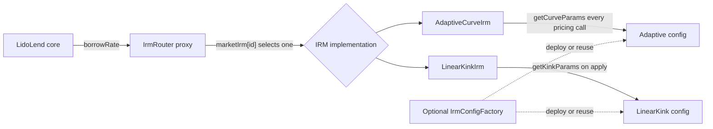
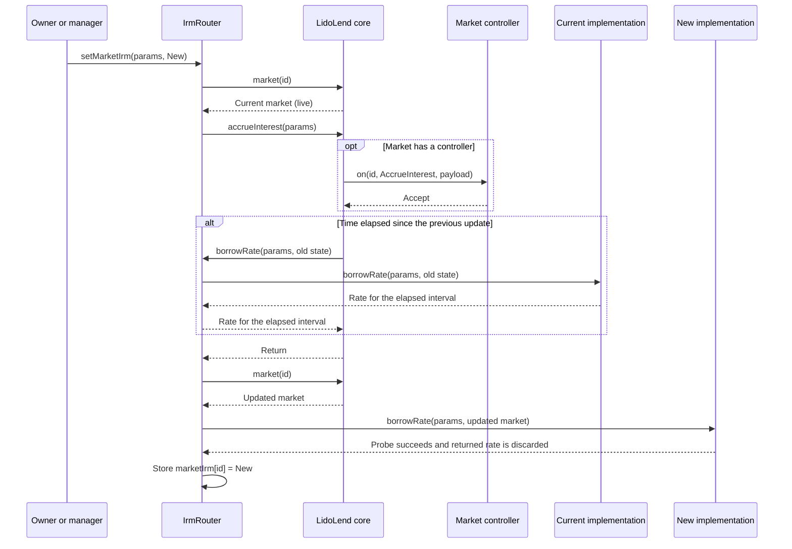

# Lido Lend IRM specification

This document specifies the Lido Lend IRM router, the Adaptive and LinearKink interest-rate models, their config contracts, and the optional config factory.

## Contents

- [Terms and units](#terms-and-units)
- [Runtime topology](#runtime-topology)
- [Market identity](#market-identity)
- [Roles](#roles)
- [Shared deployment](#shared-deployment)
- [New-market setup](#new-market-setup)
- [IrmRouter](#irmrouter)
- [Live reconfiguration timing](#live-reconfiguration-timing)
- [AdaptiveCurveIrm](#adaptivecurveirm)
- [LinearKinkIrm](#linearkinkirm)
- [IrmConfigFactory](#irmconfigfactory)
- [Storage and upgrade boundaries](#storage-and-upgrade-boundaries)
- [Trust assumptions and failure modes](#trust-assumptions-and-failure-modes)
- [References](#references)

## Terms and units

| Term | Meaning |
| --- | --- |
| Market | One LidoLend market identified by `MarketParams`. |
| `Id` | `keccak256(abi.encode(MarketParams))`. |
| IRM | Interest-rate model. It returns a WAD-scaled per-second borrow rate. |
| Router | The stable IRM address stored in a market's `MarketParams`. It forwards pricing to a selected implementation. |
| Implementation | The address selected for one market by the router. The supplied implementations implement `IIrm`; route configuration itself checks only that the address is non-zero. |
| Config | A contract that returns one model's parameters. It does not become active until an authorized caller applies it. |
| WAD | Fixed-point scale `1e18`. Ratios use WAD. Rates use WAD per second. |
| `YEAR` | `365 days`. In this document, `x/year` means `floor(x * WAD / YEAR)` per second. |
| Utilization | `totalBorrowAssets / totalSupplyAssets`, WAD-scaled. |
| Live market | A market whose core `lastUpdate` is non-zero. |
| Uncreated market | A `MarketParams` id whose core `lastUpdate` is zero. |
| Reconfiguration | Applying new parameters to the same model instance and market id. |
| Migration | Changing the router's selected model implementation for a market. |

The imported core interfaces retain Morpho names such as `IMorpho` and `IIrm`. In this repository, `MORPHO` refers to the LidoLend core address.

## Runtime topology

A LidoLend market cannot change the `irm` field in its `MarketParams`. Router-fronted markets therefore store the router address, not an Adaptive or LinearKink address. The router chooses the current implementation in a separate mapping keyed by market id.



| Property | AdaptiveCurveIrm | LinearKinkIrm |
| --- | --- | --- |
| Model | Stateful adaptive curve | Non-adapting piecewise-linear curve |
| Per-market state | `rateAtTarget` and config address | Four copied curve parameters |
| Config use | Live read on every pricing call | One read during `applyIrmConfig` |
| `borrowRate` | Changes state and accepts only the configured router | View-only and accepts any caller |
| Logic upgrade | Deploy a new implementation and migrate through the router | Deploy a new implementation and migrate through the router |

The Adaptive and LinearKink implementations are direct, non-proxied contracts. The router is proxied. The config contracts included in this repository are immutable.

Both model-specific interfaces inherit `IConfigurableIrm` and expose the same `applyIrmConfig(MarketParams,address)` ABI with `IrmConfigApplied(Id indexed marketId,address indexed config)`. This setter is the shared abstraction; each model retains its own runtime representation.

## Market identity

`MarketParams` contains five fields: loan token, collateral token, oracle, IRM, and LLTV. All five fields are part of the market id.

For a router-fronted market:

- `marketParams.irm` must be the router address.
- `setMarketIrm` enforces this condition when assigning the route.

`applyIrmConfig` supports both pre-creation setup and live reconfiguration. It does not query the core or distinguish between those cases; it stores the configuration under the id derived from the supplied `MarketParams`. During initial setup, later routing and creation use that configuration only if they use the same final `MarketParams`. During live reconfiguration, different `MarketParams` update another id and leave the existing market's configuration unchanged.

## Roles

`IrmRouter`, `AdaptiveCurveIrm`, and `LinearKinkIrm` use the same two-role base:

| Role | Power |
| --- | --- |
| Owner | May rotate the owner and manager. It also has every operational permission held by the manager. |
| Manager | May change market routes on the router or apply market configs on an IRM. It cannot rotate either role. |

Both role addresses must be non-zero. The three contracts have independent owner and manager storage. The product deployment may assign the same addresses, but the contracts do not enforce that topology.

The router proxy admin is a separate authority. Until the proxy is ossified, it can replace router logic and is more powerful than the router owner or manager.

## Shared deployment

The shared contracts are normally deployed once:

1. Deploy `IrmRouter(core)`, then deploy its proxy with constructor calldata for `initialize(owner, manager)` so initialization is atomic.
2. Deploy the desired IRM implementation with its owner and manager. Adaptive also receives the router address as its only state-changing pricing caller.
3. Optionally deploy `IrmConfigFactory` for reusable immutable configs.

Verify the proxy admin, router `MORPHO`, router roles, and IRM roles before routing a market.

## New-market setup

For each router-fronted market:

1. Build the final `MarketParams` with `irm` set to the router.
2. Obtain a compatible config. The optional factory can deploy or reuse one of the included immutable configs.
3. Call `applyIrmConfig` on the selected IRM with the final `MarketParams`.
4. Call `setMarketIrm` on the router with the same `MarketParams` and selected implementation.
5. The LidoLend owner creates the market.

Steps 3 and 4 may occur in either order before creation. Pre-creation routing stores the pointer without calling the selected implementation. Market creation writes `lastUpdate` and then calls `borrowRate`; creation reverts if that call reverts, but the core neither uses the returned rate nor checks it against a bound.

Before creation, verify `marketIrm[id]`, the selected config or copied parameters, and `borrowRateView` using the exact final `MarketParams`.

The permissionless config factory does not apply a config, set a route, or create a market.

## IrmRouter

`IrmRouter` is the stable IRM address stored in each router-fronted market. It stores the selected implementation by market id and forwards pricing calls to it, allowing the route to change without changing `MarketParams`.

### Pricing

`borrowRate(marketParams, market)` first checks that its caller is `MORPHO`, then loads `marketIrm[id]` and calls that implementation's `borrowRate`. `borrowRateView` has no caller gate and forwards to the implementation's view function. After the core-only caller check passes, both paths revert with `IRM_NOT_SET` when the route is zero.

The router calls implementations with a normal external call, not `delegatecall`. Each implementation therefore owns its own per-market state.

> [!WARNING]
> **Selected implementations are trusted code.** Pricing is an ordinary external call, and neither the router nor the core holds a reentrancy lock while the implementation runs. A malicious implementation can reenter core accrual before the outer accrual writes `lastUpdate`, causing the same interval to accrue more than once. Route only reviewed, non-reentrant implementations.

### Setting a route

`setMarketIrm(marketParams, newIrm)` is owner-or-manager gated. It rejects a zero address and rejects `MarketParams` whose `irm` is not the router. It does not check bytecode, interface support, or rate bounds.

For an uncreated market, the router stores `newIrm` and emits `MarketIrmSet`. It does not call the implementation. This preserves the first-call seed of a stateful Adaptive implementation.

For a live market, the order is exact:



The router always asks the core to accrue before switching. The core performs the controller-hook phase first and calls the controller when one is bound. A controller veto or pause, a core accrual failure, or an old-route failure therefore blocks migration before the new probe. If no time has elapsed since the previous update, the core still performs the hook phase but returns without calling the old route.

After accrual, the new implementation is probed from the router address against the latest market state. The new route is stored only after that call succeeds.

The probe discards the returned rate, so it proves only that one call does not revert in the current state. Setting a live market to its already selected implementation still calls core accrual, probes, writes the same pointer, and emits `MarketIrmSet`.

> [!WARNING]
> **A failing active route can block migration.** The probe tests one call in the current state. If the active implementation later makes elapsed-time accrual revert, `setMarketIrm` cannot switch away because it calls that failing accrual first.
>
> With the current core and router logic, recovery requires repairing or reconfiguring the active implementation. While the proxies remain upgradeable, the core proxy admin can change the accrual path, or the router proxy admin can install a safe route without the failing accrual. If no time has elapsed, the core does not call the old route and a normal switch can still succeed.

### Migration behavior

- Leaving an Adaptive implementation stops pricing calls from updating that instance's `rateAtTarget[id]`. An authorized `applyIrmConfig` call may still clamp a non-zero stored value while the implementation is detached.
- A fresh Adaptive implementation seeds from its configured `initialRateAtTarget` during the live probe.
- Returning to a previously used Adaptive implementation resumes its stored non-zero `rateAtTarget` unless it was reconfigured while detached.
- LinearKink has no adapting state. Migration changes which stored parameter set prices the next interval.

To carry `rateAtTarget` to a fresh Adaptive implementation, call core `accrueInterest` while the old route is selected, read the updated value, and use it as the new config's `initialRateAtTarget`. Switch before time advances or the old implementation is reconfigured; either change can make the copied value stale.

Before a live switch, verify the candidate config and returned rate for the exact `MarketParams`. After the switch, verify `marketIrm[id]` and `borrowRateView` again.

### Router initialization and proxy

The router implementation constructor stores immutable `MORPHO` and sets `isInitialized = true` in the implementation's own storage. A new proxy starts with zeroed router storage and calls `initialize(owner, manager)` once. Initialization rejects zero roles. Without constructor-time initialization, the first caller can claim the proxy.

## Live reconfiguration timing

> [!WARNING]
> **Reconfiguration can reprice unaccrued time.** `applyIrmConfig` does not accrue the market. If the selected implementation's parameters change after time has elapsed since `lastUpdate`, the next accrual uses the new parameters for the entire interval, including the time before the change. To close that interval under the old parameters, call core `accrueInterest` immediately before `applyIrmConfig` in the same transaction. For a mutable Adaptive config, call core `accrueInterest` immediately before mutating the config in the same transaction.

## AdaptiveCurveIrm

AdaptiveCurveIrm is the Morpho adaptive curve with per-market parameters and an optional output cap. It stores one config address and one adapting `rateAtTarget` for each market id. With the upstream parameter values and `maxBorrowRate == 0`, its rate calculation remains upstream-compatible.

### Adaptive config application

`applyIrmConfig(marketParams, config)` is owner-or-manager gated. It calls `getCurveParams()`, stores the exact config address, clamps a non-zero stored `rateAtTarget` into the returned `[minRateAtTarget, maxRateAtTarget]` band, and emits `IrmConfigApplied`.

The IRM checks neither the config's bytecode nor its returned values. ABI decoding must succeed, but semantic validity is the authorized caller's responsibility. A zero address, externally owned account (EOA), removed contract, or incompatible contract fails when `getCurveParams()` does not return decodable data.

When `marketCurveConfig[id]` is zero, `borrowRateView` reverts with `CONFIG_NOT_SET`; `borrowRate` does the same after its `ROUTER` caller check passes.

The stored address is a live binding. Every later pricing call reads `getCurveParams()` again. A mutable config can change pricing or start reverting without a new `IrmConfigApplied` event. Mutating its rate band also bypasses the immediate stored-rate clamp performed by `applyIrmConfig`. If the new band excludes the current `rateAtTarget`, a pricing call that performs no adaptation, for example because no time has elapsed, can still use the out-of-band value.

An authorized caller can replace a failing Adaptive config by applying a valid one because application does not call the previously stored config.

The included `AdaptiveCurveConfig` validates its values in the constructor:

| Parameter | Included config bound |
| --- | --- |
| `curveSteepness` | `1 WAD` to `100 WAD` (1x to 100x) |
| `adjustmentSpeed` | `[0, 10_000/year]`, WAD per second |
| `targetUtilization` | Greater than zero and less than `WAD` |
| `minRateAtTarget` | Greater than zero |
| `maxRateAtTarget` | At least the minimum and at most `10_000/year` |
| `initialRateAtTarget` | Inside the minimum and maximum band |
| `maxBorrowRate` | Zero, or no greater than the maximum permitted target rate multiplied by 100x |

The curve and adaptation bounds protect the included implementation's arithmetic for protocol-reachable utilization. The `maxBorrowRate` ceiling rejects a cap above the maximum output at utilization no greater than `WAD` under the global parameter limits and catches common unit errors. These bounds do not determine whether a parameter set is economically suitable. The IRM itself does not enforce them.

### Adaptive rate calculation

Unsigned utilization division rounds down. Signed WAD operations use:

```text
wMul0(x, y) = truncTowardZero(x * y / WAD)
wDiv0(x, y) = truncTowardZero(x * WAD / y)
```

Let:

- `S = totalSupplyAssets`;
- `B = totalBorrowAssets`;
- `U* = targetUtilization`, WAD-scaled;
- `C = curveSteepness`, WAD-scaled;
- `r0 = stored rateAtTarget`, WAD per second;
- `a = adjustmentSpeed`, WAD per second;
- `T = block.timestamp - market.lastUpdate`, in seconds.

Utilization is:

```text
U = 0                                  if S == 0
U = floor(B * WAD / S)                 otherwise
```

AdaptiveCurveIrm does not clamp an adversarial `U` above `WAD`. Protocol-reachable LidoLend state maintains `B <= S`; callers of the view function must supply a matching market state.

The normalized utilization error is:

```text
e = wDiv0(U - U*, U*)                   when U <= U*
e = wDiv0(U - U*, WAD - U*)             when U > U*
```

For protocol-reachable utilization, `e` is in `[-WAD, WAD]`. The curve at a target rate `r` is:

```text
coefficient = WAD - wDiv0(WAD, C)        when e < 0
coefficient = C - WAD                    when e >= 0
curve(r, e) = wMul0(WAD + wMul0(coefficient, e), r)
```

If `r0 == 0`, the calculation takes the seed branch. With a config accepted by the included `AdaptiveCurveConfig`, zero also identifies an uninitialized market because `initialRateAtTarget` must be positive. An arbitrary config may return a zero initial rate and make the seed branch repeat. Earlier `borrowRateView` calls may have evaluated the branch without storing it:

```text
averageRateAtTarget = initialRateAtTarget
endRateAtTarget     = initialRateAtTarget
```

If `r0 != 0`, define `speed = wMul0(a, e)` and `z = speed * T`. When `z == 0`, the implementation does not call the exponential helper and does not clamp the stored value:

```text
averageRateAtTarget = r0
endRateAtTarget     = r0
```

When `z != 0`:

```text
end   = clamp(wMul0(r0, wExp(z)),   minRateAtTarget, maxRateAtTarget)
mid   = clamp(wMul0(r0, wExp(z/2)), minRateAtTarget, maxRateAtTarget)
averageRateAtTarget = (r0 + end + 2 * mid) / 4
endRateAtTarget     = end
```

`wExp` is the WAD-scaled approximation and saturation function defined by `ExpLib.wExp`.

The calculation holds the pre-accrual utilization error `e` constant for the complete interval `T`. Interest can raise utilization during that interval, so the fixed-error approximation can understate the rate. The three-point expression is the implementation's trapezoidal approximation of the interval-average target rate. The raw borrow rate is `curve(averageRateAtTarget, e)`, not `curve(endRateAtTarget, e)`.

Finally:

```text
returnedRate = rawBorrowRate                                      if maxBorrowRate == 0
returnedRate = min(rawBorrowRate, maxBorrowRate)                  otherwise
```

The cap does not change `endRateAtTarget` in the current call. When it binds, it lowers accrued interest; this can change later utilization and future adaptation.

`borrowRateView` performs this calculation without saving the end value and without emitting an event. `borrowRate` accepts only `ROUTER`, stores `endRateAtTarget`, emits `BorrowRateUpdate(id, returnedRate, endRateAtTarget)`, and returns the same calculated rate.

### Adaptive reconfiguration

Applying a config again changes the live config address and immediately clamps any non-zero stored `rateAtTarget` into the new band. A zero stored value remains zero so the next state-changing pricing call still uses the first-call seed.

### Adaptive periphery library

`AdaptiveCurveIrmLib` reads the selected config, stored `rateAtTarget`, and market state to reproduce `borrowRateView` and expected balances. It is intended for a market currently routed to that exact Adaptive implementation.

When the library reads the config, the config sees the calling periphery contract as `msg.sender`; during live pricing, it sees `AdaptiveCurveIrm`. A config that returns different values or reverts based on `msg.sender` can therefore make the library's rate or expected-balance calculation disagree with live pricing. The included `AdaptiveCurveConfig` does not depend on `msg.sender`.

## LinearKinkIrm

LinearKinkIrm is a non-adapting piecewise-linear model. One instance stores one packed parameter set per market id.

### LinearKink config application

`applyIrmConfig(marketParams, config)` is owner-or-manager gated. It calls `getKinkParams()`, copies the returned values into `marketKinkParams[id]`, and emits `IrmConfigApplied` with the supplied config address.

The config address is not stored. Later mutation or failure of that config cannot change pricing. The function performs no value validation. A stored zero `optimalUtilization` means the market is not configured and makes both pricing functions revert with `CONFIG_NOT_SET`.

The included `LinearKinkConfig` requires `0 < optimalUtilization < WAD` and `baseRate + slope1 + slope2 <= 8/year` (an 800% nominal annual rate). This ceiling exists only in the included config constructor. LinearKinkIrm does not enforce it on arbitrary getter output.

### LinearKink rate calculation

Utilization is `floor(totalBorrowAssets * WAD / totalSupplyAssets)`, or zero when total supply is zero. Unlike Adaptive, LinearKink clamps utilization to `WAD` before applying the curve. Let `U` be this clamped utilization.

For any non-zero stored `optimalUtilization`:

```text
U <= optimalUtilization:
    rate = baseRate + floor(slope1 * floor(U * WAD / optimalUtilization) / WAD)

U > optimalUtilization:
    excess = floor((U - optimalUtilization) * WAD / (WAD - optimalUtilization))
    rate = baseRate + slope1 + floor(slope2 * excess / WAD)
```

When `0 < optimalUtilization < WAD`, the rate is `baseRate` at zero utilization, `baseRate + slope1` at the kink, and `baseRate + slope1 + slope2` at full utilization. For every non-zero stored `optimalUtilization`, the rate is non-decreasing in `U`; floor rounding can only create flat steps.

Both `borrowRate` and `borrowRateView` are view-only and return the same value. There is no pricing caller gate.

### LinearKink reconfiguration

Applying a config again overwrites the complete per-market snapshot.

## IrmConfigFactory

`IrmConfigFactory` is optional and permissionless. It keeps separate mappings for Adaptive and LinearKink configs.

`getOrDeployAdaptiveCurveConfig(params)` and `getOrDeployLinearKinkConfig(params)` compute `keccak256(abi.encode(params))` in separate model-specific mappings. A cache hit returns the existing address. A cache miss deploys the included immutable config, stores it, emits the model-specific deployment event, and returns it. If constructor validation fails, no config is deployed or cached.

The read-only `getAdaptiveCurveConfig(params)` and `getLinearKinkConfig(params)` functions return the cached address or zero. Reuse is scoped to one factory instance and one exact ABI-encoded parameter set.

The mappings are deploy-or-reuse caches, not allowlists or sources of authorization. The IRMs do not reference the factory and accept any ABI-compatible config selected by an authorized caller.

## Storage and upgrade boundaries

| Contract | Storage |
| --- | --- |
| AdaptiveCurveIrm | Slot 0 owner, slot 1 manager, slot 2 `rateAtTarget`, slot 3 `marketCurveConfig`. |
| LinearKinkIrm | Slot 0 owner, slot 1 manager, slot 2 `marketKinkParams`. Each mapping value packs four `uint64` parameters into one slot. |
| IrmRouter proxy | ERC-7201 namespace `lido.lend.storage.IrmRouter`: owner at base; manager at offset 0 and `isInitialized` at offset 20 of base + 1; `marketIrm` at base + 2. |
| IrmConfigFactory | Slot 0 Adaptive config cache; slot 1 LinearKink config cache. |

The IRM implementations are not proxied. Their code cannot change in place. A new model implementation requires a router migration.

The router proxy preserves its namespaced storage across a compatible upgrade. `MORPHO` is immutable in the router implementation bytecode, not stored in the proxy. Upgrading to logic constructed for another core preserves routes but makes the old core fail the router's `NOT_MORPHO` check, disconnecting every existing market on that core. A compatible live upgrade therefore keeps the same `MORPHO`. Before ossification, the proxy admin may also write router storage through new code. New router fields must preserve the existing namespace layout and append from base + 3.

## Trust assumptions and failure modes

| Actor or dependency | Power and limitation |
| --- | --- |
| Router owner | May rotate router roles and submit any non-zero route; a live assignment succeeds only after accrual and the candidate call succeed. |
| Router manager | May submit the same routes as the owner but cannot rotate roles. |
| IRM owner | May rotate that IRM's roles and apply any ABI-compatible config to any id. |
| IRM manager | May apply any ABI-compatible config to any id, but cannot rotate roles. |
| LidoLend core proxy admin | May replace core logic until the core proxy is ossified, including its pricing and accrual interaction with the router. |
| Router proxy admin | May replace router logic until it permanently ossifies the proxy; replacement logic is not constrained by current owner-or-manager checks. |
| LidoLend core | Is trusted to pass the matching current `Market` for `MarketParams` and to be the router's only state-changing pricing caller. |
| Selected implementation | Executes as external trusted code during core accrual. The router validates neither its rate nor its future behavior. |
| Adaptive config | Is trusted to return valid values on every pricing call. It may be mutable or caller-dependent unless governance restricts it. |
| LinearKink config | Is trusted only during application; pricing uses the copied snapshot. |
| Permissionless factory | Anyone may deploy or reuse an included config. The factory does not apply it; activation remains owner-or-manager gated on the IRM. |

## References

- [Morpho Blue IRMs at the fork point](https://github.com/morpho-org/morpho-blue-irm/tree/a1a87fd5a7ee13873ea9d2bbd87e9c7b2cdbbef3) for inherited Adaptive math.
- [FORK_NOTES.md](FORK_NOTES.md) for the source delta.
- [TEST_PLAN.md](TEST_PLAN.md) for Foundry and Certora coverage.
- [`IConfigurableIrm.sol`](src/common/IConfigurableIrm.sol) for the shared config-application ABI.
- [`IrmRouter.sol`](src/irm-router/IrmRouter.sol), [`AdaptiveCurveIrm.sol`](src/adaptive-curve-irm/AdaptiveCurveIrm.sol), [`AdaptiveCurveMathLib.sol`](src/adaptive-curve-irm/libraries/AdaptiveCurveMathLib.sol), [`ExpLib.sol`](src/adaptive-curve-irm/libraries/ExpLib.sol), [`LinearKinkIrm.sol`](src/linear-kink-irm/LinearKinkIrm.sol), and [`IrmConfigFactory.sol`](src/irm-config-factory/IrmConfigFactory.sol) for the implementation.
- [Lido Lend Markets](https://github.com/lidofinance/lend-markets) for proxy deployment and concrete role holders.
