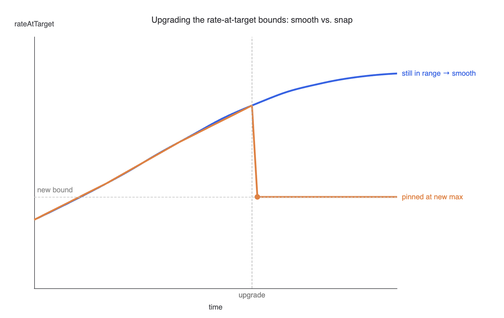
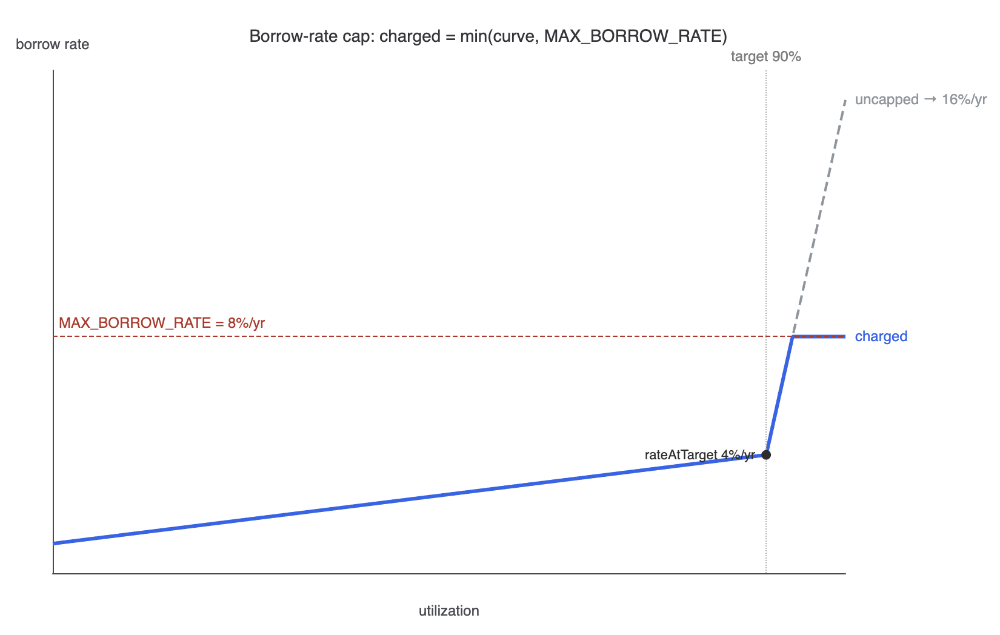

# AdaptiveCurveIrm

## Overview

`AdaptiveCurveIrm` is the interest rate model (IRM) Morpho Blue calls to set a market's borrow rate. It maps utilization to a per-second rate through a curve whose height, `rateAtTarget`, is the rate charged at target utilization. That height adapts over time to pull utilization back toward the target, with no governance action required.

The curve and its adaptation are the [upstream Morpho model](https://github.com/morpho-org/morpho-blue-irm) (`morpho-org/morpho-blue-irm` @ `2bce6da`, `src/adaptive-curve-irm/AdaptiveCurveIrm.sol`), **unchanged** in this fork. Anything not specified in this document matches that source; it and the Morpho whitepaper are the normative reference for the exact formulas. This document specifies only the additions of the Lido version:

- **per-deployment configuration** — the curve constants become validated constructor inputs, so each market can define its own curve;
- **upgradeability** — a proxy lets governance change those (otherwise immutable) parameters without redeploying the market;
- an optional **borrow-rate cap** — a hard upper bound on the rate charged to borrowers, applied to the curve's output.

The `borrowRate` / `borrowRateView` interface is unchanged, so the model is a drop-in replacement. `borrowRate` is still Morpho-only and state-changing; `borrowRateView` is still public and read-only.

## Configuration

Upstream, every market shares one curve, since its parameters are compile-time constants and the constructor takes none of them. Lido runs several markets that may each want a different curve, so the fork moves those constants into a per-deployment `Config` of **immutables** passed to the constructor. The curve math that reads them is byte-identical to upstream.

| Parameter | Validation |
| --- | --- |
| `curveSteepness` (WAD) | in `[WAD, 100*WAD]` |
| `adjustmentSpeed` (WAD/s) | in `[0, ~10000/year]` |
| `targetUtilization` (WAD) | in `(0, WAD)` |
| `initialRateAtTarget` (WAD/s) | in `[minRateAtTarget, maxRateAtTarget]` |
| `minRateAtTarget` (WAD/s) | `> 0` |
| `maxRateAtTarget` (WAD/s) | in `[minRateAtTarget, ~1e6%/year]` |
| `maxBorrowRate` (WAD/s) | `>= 0` (`0` = disabled) |

Now that the parameters are inputs, a deployment can supply values upstream never could. `_validateConfig` checks them in the constructor and reverts if any falls outside the bounds in the table. Those bounds keep the curve math inside its non-overflowing range, so `borrowRate` runs without reverting and returns a non-negative rate. They only guarantee that the market works, not that the curve makes economic sense. The deployer can choose any values inside the bounds.

## Upgradable

Upstream a deployment's curve cannot change, since the parameters are constants; using a different curve means launching a new market. In the fork the parameters are immutables baked into the implementation, while the contract's only storage holds `rateAtTarget` (slot 0, as upstream). A single implementation can then sit behind an upgradeable **proxy**. Governance reparametrizes a live market by pointing the proxy at a new implementation that carries a new `Config`, and `rateAtTarget` survives the swap because it lives in proxy storage. There is no parameter setter, so changing the curve always means an upgrade, and the proxy admin (governance) controls that until the proxy is ossified.

The new parameters take effect on the **next** `borrowRate` call, where they can shift the rate:

| New parameter | Effect on the next call | Timing |
| --- | --- | --- |
| `MAX_BORROW_RATE` | borrow rate limited to the new cap, `rateAtTarget` untouched | immediate, even at target |
| `curveSteepness` | new slope: the same `rateAtTarget` and utilization give a different borrow rate | immediate |
| `targetUtilization` | the error is recomputed for the same utilization, so the rate shifts | immediate |
| `minRateAtTarget` / `maxRateAtTarget` | the new bound snaps the saved `rateAtTarget` into the new range | lazy (see below) |
| `adjustmentSpeed` | changes the speed of future adaptation | gradual |

Only a change to the `minRateAtTarget` / `maxRateAtTarget` bounds can move the stored `rateAtTarget` discontinuously. When the new range still contains the stored value (for instance, a widened range), adaptation continues from where it was, with no jump. When the range is **narrowed** below the current value, the next adapting call snaps `rateAtTarget` to the nearest new bound in one step; the size of that jump is the gap between the old value and the new bound, which governance sets by choosing the bound.

The graph illustrates both: a new range that still contains the stored `rateAtTarget` (smooth), and a new `maxRateAtTarget` below it (snap down).



Two more things to know about an upgrade:

* **The re-clamp is lazy.** `rateAtTarget` is re-clamped into the new range only on a call where utilization is off target **and** time has elapsed. An upgrade that tightens the range followed by an at-target (or same-block) call leaves `rateAtTarget` out of range, used unchanged, until a later off-target call snaps it in. `MAX_BORROW_RATE` is the only bound that applies immediately in that interval.
* **The new parameters apply to the whole period since the last update.** The first `borrowRate` after an upgrade averages over the entire interval since `market.lastUpdate`, which may precede the upgrade; old and new parameters are not blended at the upgrade timestamp. To settle the pre-upgrade interval at the old parameters, call `accrueInterest` immediately before upgrading.

## Borrow-rate cap

Upstream puts no ceiling on the charged rate. Above target the curve multiplies `rateAtTarget` by up to `curveSteepness`; with `curveSteepness` 4 and 4%/year at target, the rate runs from 1%/year at zero utilization to 16%/year at full utilization, and climbs further as `rateAtTarget` adapts toward `maxRateAtTarget`. The fork adds an optional hard ceiling on what a borrower can be charged, applied to the **output** returned to Morpho:

```
returned = min( curveRate,  MAX_BORROW_RATE )      # only when MAX_BORROW_RATE != 0
```

The cap only clamps the returned value and never touches the stored `rateAtTarget`. Adaptation responds to the utilization error rather than the current rate, so clamping `rateAtTarget` would interfere with the control loop, while clamping the output leaves it running exactly as upstream. The state machine behaves the same whether the cap is on or off, and raising or removing the cap brings the borrow rate straight back to the curve value on the next call.

The cap clips the high-utilization peak of the curve, or the whole curve if it sits below `rateAtTarget`. Setting `MAX_BORROW_RATE` to 0 turns it off. A cap below the curve's operating range makes the market effectively interest-free; that is what the chosen value does, and avoiding it is on the deployer, not a contract defect.

With an `8%/year` cap on the same curve, the charged rate follows the curve, then holds flat where it would otherwise exceed the cap.



## Periphery library

`AdaptiveCurveIrmLib` recomputes `borrowRateView` and `expectedMarketBalances` from a market `Id` alone, for integrators that hold the id rather than the full `MarketParams`. Because a proxied IRM can be reparametrized, it differs from upstream in three ways:

- it reads the curve parameters **live from the IRM instance** (via the immutable getters) rather than upstream constants, tracking whichever implementation the proxy currently points to, and applies the same cap;
- its results are **instance-specific**, per the deployed `Config`, and must be queried with the market's actual `AdaptiveCurveIrm` address;
- equivalence to the contract is **proven in Certora**, for both the returned values and the revert conditions.

## Trust Assumptions

This section states what each actor can do to the model. Who holds each role, and through what process it acts, is a governance matter outside this spec.

**Proxy admin** (governance) can replace the implementation, swapping the entire curve, and with it every future rate the market reads, in a single upgrade; `rateAtTarget` carries across the swap. This is the largest trust the design places. Upstream the IRM is immutable; here it is not. The trade is deliberate, and constraints on the admin (timelock, governance) are operational and outside this spec. The power ends once the proxy is ossified. The model never custodies funds, so this is power over the rate Morpho reads, not over deposits.

**Deployer** fixes the `Config` when an implementation is built. Validation only keeps the values in a working range (see Configuration); whether the resulting curve is economically sound, and whether `MAX_BORROW_RATE` is set sensibly, is the deployer's judgment. No in-range config can make `borrowRate` revert or return a negative rate.

**Morpho** is the only caller of state-changing `borrowRate`; `borrowRateView` is public and read-only. The model has no other privileged caller, and it depends on no external contract beyond the Morpho market that calls it.

## References

- Upstream IRM source at `morpho-org/morpho-blue-irm` @ `2bce6da` and the Morpho whitepaper — normative for the curve and its adaptation.
- `FORK_NOTES.md` — the fork point and the full per-file delta against upstream.
- `src/adaptive-curve-irm/interfaces/IAdaptiveCurveIrm.sol` — the typed contract surface: curve getters, `MAX_BORROW_RATE`, and the inherited `IIrm` interface.
- `src/adaptive-curve-irm/libraries/periphery/AdaptiveCurveIrmLib.sol` — the periphery recompute library described above.
